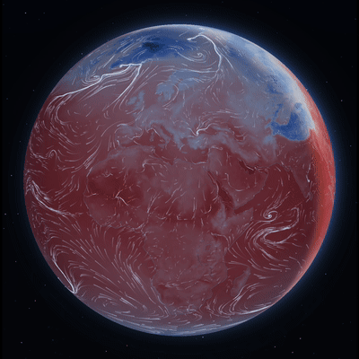
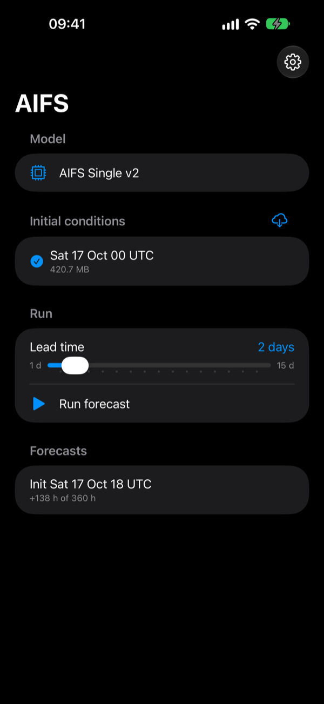
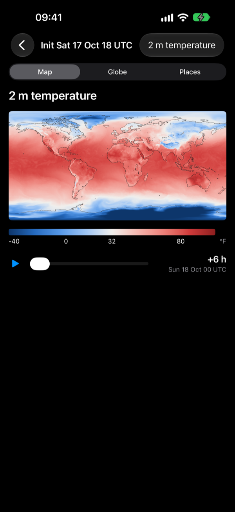
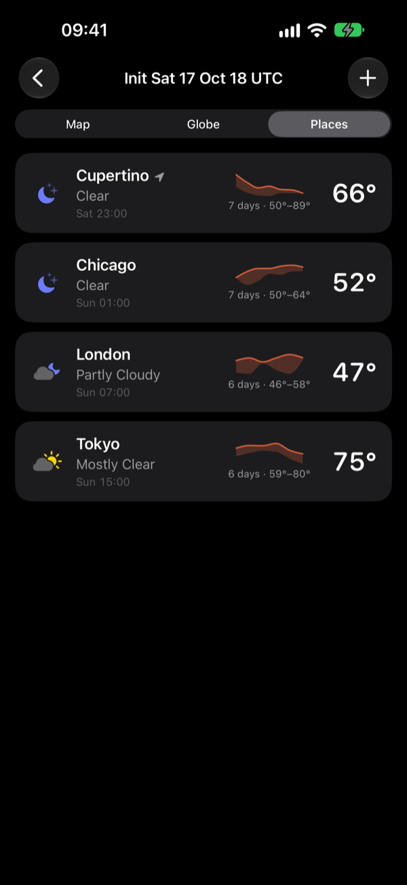
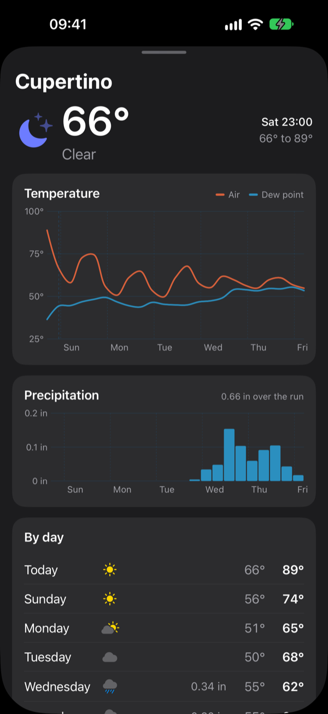

# AI Forecast Factory

Run ECMWF's **AIFS Single v2** global weather model entirely on an iPhone, iPad or Apple
silicon Mac. The app downloads the latest initial conditions from ECMWF open data,
computes the forecast on the device's GPU and Neural Engine, and shows the result as a
map, interactive globes, and forecasts for places you save.

<p align="center">
  
</p>

<p align="center">
  
  
  
  
</p>

## Running it

Needs Xcode 27 and a device on iOS/iPadOS 27, or an Apple silicon Mac, with about 4 GB of
memory free for the app.

1. Open `AIFS-iOS-app.xcodeproj`, set your own team and bundle identifier under
   *Signing & Capabilities*, and run on a device or *My Mac (Designed for iPad)*.
2. In the app, tap **Download the model** (about 1 GB, from
   [Hugging Face](https://huggingface.co/amarchakitus/aifs-single-v2-mlx)).
3. Download the latest initial conditions, pick a lead time, and tap **Run forecast**.

The simulator shows the viewers but can't run the model: MLX needs a real Metal device.

Development tooling is compiled in only when the build setting `AIFS_DEVELOPER` is `YES`
(in the target's build settings, or `xcodebuild … AIFS_DEVELOPER=YES`). That adds memory
and thermal readouts during a run, the launch-argument hooks in
`AIFS-iOS-app/Developer/LaunchOptions.swift`, the Neural Engine probe and benchmark, and
diagnostic logging.

## How it works

PyTorch doesn't run on iOS, so the network is reimplemented in
[MLX Swift](https://github.com/ml-explore/mlx-swift) and fed a bundle converted from
ECMWF's checkpoint: fp16 weights, the encoder and decoder graphs, the regridding
operators, and the processor compiled to Core ML, so its dense layers run on the Neural
Engine while the GPU does attention. The bundle is the Hugging Face repo above.

```
AIFS-iOS-app/   the SwiftUI app
AIFSKit/        Swift package: the model, rollout, open-data client (GRIB2, vendored libaec),
                map rendering, and a macOS CLI (aifs-mlx) used for validation
aifs-mps/       submodule: AIFS-MPS, the PyTorch pipeline the exporter builds on
tools/bundle/   the exporter: checkpoint -> bundle, initial states for the device
tools/          Core ML export of the processor; app icon generator
docs/           privacy policy
```

To build the bundle yourself from the ECMWF checkpoint:

```bash
git submodule update --init
aifs-mps/aifs setup                                    # Python runtimes and checkpoints
tools/bundle/aifs-export bundle                        # -> exports/aifs-single-v2/
uv run tools/export_coreml.py exports/aifs-single-v2   # + coreml/, the Neural Engine part
```

Then copy `exports/aifs-single-v2` into the app's Documents (Finder, or the Files app).

## Speed and accuracy

| device | per 6-hour step |
|---|---|
| MacBook Pro (M4 Max) | ~4.5 s |
| iPhone 18 Pro Max (A19 Pro) | ~5.9 s |
| iPad Pro 12.9" (M1) | ~15.5 s |

A step peaks at about 3.1 GB. If the app leaves the foreground, the run pauses (iOS allows
no GPU work in the background) and carries on when you return.

Every stage was checked against ECMWF's PyTorch pipeline. The fp32 forward pass matches
anemoi to within 3e-6 relative on every output, and the initial conditions built on the
device match within 3.3e-7. The fp16 Neural Engine path differs in 2 m temperature by
0.013 K RMS at +6 h, about a tenth of the run-to-run noise of PyTorch on Apple GPUs.

## Licence and attribution

The code is BSD 3-Clause ([LICENSE](LICENSE)); the vendored libaec keeps its BSD 2-Clause
licence. The AIFS Single v2 weights are © ECMWF under CC BY 4.0; the Aurora 1.5 weights are
© Microsoft under the MIT licence. The initial conditions are ECMWF open data under CC BY 4.0
and the ECMWF Terms of Use. Full attribution and
third-party licences are in the app, under Settings → Licences & attribution. The privacy
policy is in [docs/privacy.md](docs/privacy.md).

This project is not affiliated with or endorsed by ECMWF or Microsoft, and its forecasts are
not theirs.
